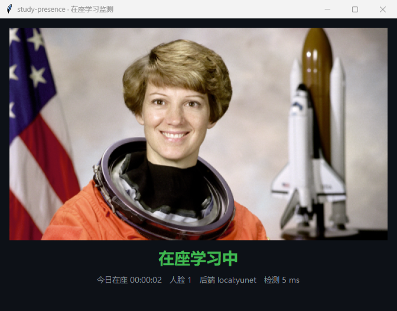

# study-presence

摄像头在座学习状态监测：定时取帧 → 人脸检测 → 去抖状态机 → 在座时长入库，Tkinter 窗口实时展示。

检测后端可插拔：默认本地离线 OpenCV YuNet（画面不出本机、零调用成本），可切到百度云人脸检测 API。



## 功能

- 实时预览 + 「在座 / 离座」状态，连续 N 次观测才翻转，抑制单帧误检与短暂起身
- 今日累计在座时长：每次在座区间写入 SQLite，程序重启后仍可累加
- 后端可切换：`local`（离线 YuNet）／`baidu`（云端 detect，密钥只从 `.env` 读）
- 失败不静默：检测或相机出错时把原因显示在窗口里，不把网络错误伪装成「没人」
- 在座时长报表：按天切分历史记录，输出合计与日均，可导出 CSV

## 架构

```
CameraSource ──frame──▶ PresenceMonitor (worker thread)
                            │  每 N 秒
                            ▼
                     Detector (local:yunet | baidu:detect)
                            │  face_count
                            ▼
                     PresenceTracker（去抖状态机）
                            │  PresenceEvent
                            ▼
                     PresenceStore（SQLite session 表）

     FrameUpdate / StatusUpdate ──queue──▶ StudyPresenceWindow（Tk 主线程）
```

- **单写者**：相机、检测器、存储只在 worker 线程里被触碰；UI 通过 `queue` 拿结果，不阻塞、不抢锁
- **帧不排队**：帧队列容量 1，UI 落后时丢弃旧帧，只渲染最新画面
- **状态与时长分离**：`PresenceTracker` 只管去抖，`PresenceStore` 只管区间入库，跨天统计由 SQL 窗口裁剪得出
- **异常显式化**：检测后端失败抛 `DetectorError`，由 worker 转成界面上的错误文案，不做 `except: pass`

## 快速开始

```bash
uv sync
uv run study-presence          # 等价于 uv run python -m app
```

首次运行 local 后端会自动下载 YuNet 模型（约 230 KB）到 `models/`；下载失败时按提示手动放到该路径即可。

常用参数：

```bash
uv run study-presence --camera 1        # 换摄像头
uv run study-presence --interval 3      # 每 3 秒检测一次
uv run study-presence --backend baidu   # 切到云端后端（需先配 .env）
uv run study-presence --source demo.mp4 # 无摄像头：用视频/图片文件当输入（视频循环播放）
```

## 在座时长报表

```bash
uv run study-presence --report        # 今天
uv run study-presence --report 7      # 近 7 天
uv run study-presence --report 30 --csv out/month.csv
```

按天切分（跨午夜的会话会拆到两天），末尾给出合计与有记录天数的日均。报表只读 SQLite，不打开摄像头、不需要检测模型。

```
在座时长（近 7 天）
2026-10-18  00:30:00
2026-10-19  00:55:00
...
合计: 06:30:00
有记录: 5 天，日均 01:18:00
```

## 配置

复制 `.env.example` 为 `.env`（已 gitignore），或用同名环境变量：

| 变量 | 默认 | 说明 |
|---|---|---|
| `SP_BACKEND` | `local` | `local` 或 `baidu` |
| `SP_CAMERA_INDEX` | `0` | 摄像头编号 |
| `SP_SOURCE` | — | 视频或图片文件路径；设置后忽略摄像头 |
| `SP_DETECT_INTERVAL_S` | `2` | 检测间隔（秒） |
| `SP_PRESENT_AFTER` | `2` | 连续几次检测到人脸才算在座 |
| `SP_ABSENT_AFTER` | `3` | 连续几次没检测到人脸才算离座 |
| `SP_DB_PATH` | `data/presence.db` | SQLite 落盘位置，窗口与报表共用 |
| `SP_BAIDU_API_KEY` | — | 百度智能云 API Key，`backend=baidu` 时必填 |
| `SP_BAIDU_SECRET_KEY` | — | 百度智能云 Secret Key，同上 |

数据落盘位置见 `SP_DB_PATH`：SQLite 的 `session` 表记录后端、开始、结束时间。

## 检测后端

| 后端 | 依赖 | 网络 | 成本 | 适用 |
|---|---|---|---|---|
| `local`（YuNet ONNX） | `opencv-python-headless` | 首次下载模型 | 无 | 日常使用，画面不出本机 |
| `baidu`（人脸检测 v3） | 百度智能云密钥 | 每次检测上传一帧 JPEG | 按调用计费 | 需要云端多属性能力的演示 |

云端后端带 token 缓存（提前 60 秒过期）与失效重取，并受 `SP_DETECT_INTERVAL_S` 节流。

## 目录结构

```
app/
├── __main__.py        # CLI 参数、依赖装配、启动
├── sources.py         # 帧来源协议：摄像头 / 视频与图片文件
├── camera.py          # cv2.VideoCapture 的封装（唯一 open/read/close 入口）
├── frames.py          # 缩放、BGR→RGB、JPEG base64
├── pipeline.py        # worker 线程：取帧 → 检测 → 状态机 → 入库
├── report.py          # 会话区间按天切分，渲染报表与 CSV
├── config/settings.py # SP_* 环境变量 → 不可变 Settings
├── detectors/         # base 协议 + local(YuNet) + baidu(云端)
├── presence/          # tracker 状态机、store 会话存储
└── ui/                # window.py 窗口（主线程只渲染）、format.py 纯展示格式化
tests/                 # 状态机、存储、帧工具、两个后端、pipeline
```

## 质量检查

```bash
uv run ruff check .
uv run ruff format --check .
uv run basedpyright
uv run pytest
```

与 `.github/workflows/ci.yml` 完全一致：push 与 PR 都会在 Ubuntu 上跑一遍。

## 设计取舍

| 决定 | 理由 | 代价 |
|---|---|---|
| 采集/检测/入库全在 worker 线程，UI 只消费队列 | 旧版在 Tk 主线程 `while True` + `sleep`，检测期间窗口冻结 | 跨线程只靠队列通信，关闭时要处理 join 时序 |
| 帧队列容量 1，满了丢旧帧 | 预览延迟比丢帧更影响观感；积压会让画面越来越落后于真实时间 | 极端卡顿时会跳帧 |
| 状态翻转要求连续 N 次同向观测 | 单帧误检不能翻转状态，起身倒水不该打断时长统计 | 翻转延迟为 N × 检测间隔 |
| 存区间而不是存累计秒数 | 累计值无法回溯校验，也不能按任意窗口重算；区间可以裁出今日、本周、任意区间 | 查询要按天切分并裁剪边界 |
| 未结束的会话查询时裁到 `now` | 崩溃或强退不会丢掉当前这段在座 | 查询多一个 `ended_at IS NULL` 分支 |
| 后端失败抛 `DetectorError` 并显示在窗口 | 旧版 `except: return False` 把网络/鉴权故障伪装成「没人学习」 | 界面多一行错误文案 |
| 默认本地 YuNet，云端作为可选后端 | 零成本、离线、画面不出本机，评审者不申请密钥也能跑通 | 本地只有人脸数，没有年龄性别等云端属性 |
| 配置只走 `SP_*` 环境变量，非法值启动即失败 | 校验集中在一处，避免隐式默认值与静默降级 | 改配置需要重启 |

## 隐私

- `local` 后端全程离线：帧只在内存里，不落盘、不上传
- `baidu` 后端会把单帧 JPEG 上传到百度云；密钥只从 `.env` 读，仓库里没有任何凭据

## Roadmap

- 托盘常驻 + 开机自启
- 多目标场景下区分「本人」与他人（当前只判断人脸数量）
- 在座趋势图表（周/月曲线，终端内或导出 HTML）

## 许可

MIT，见 [LICENSE](LICENSE)。
